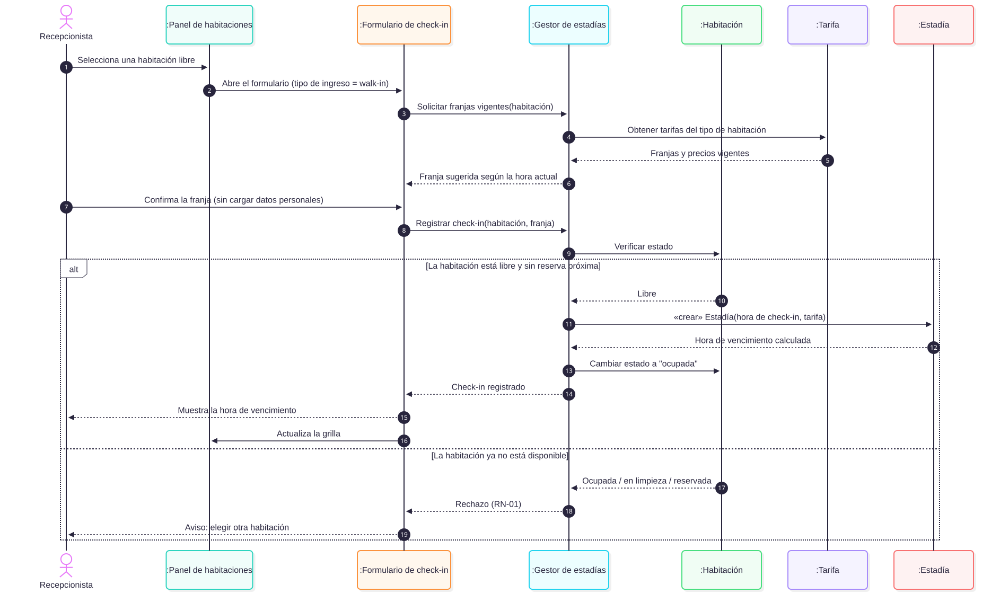
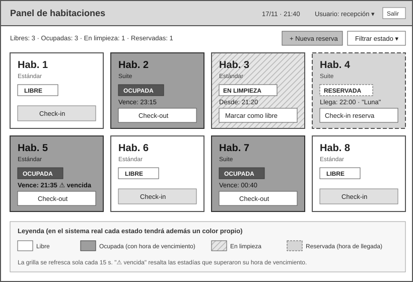
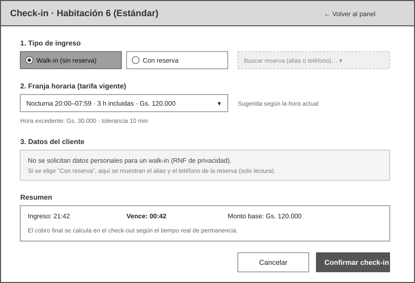
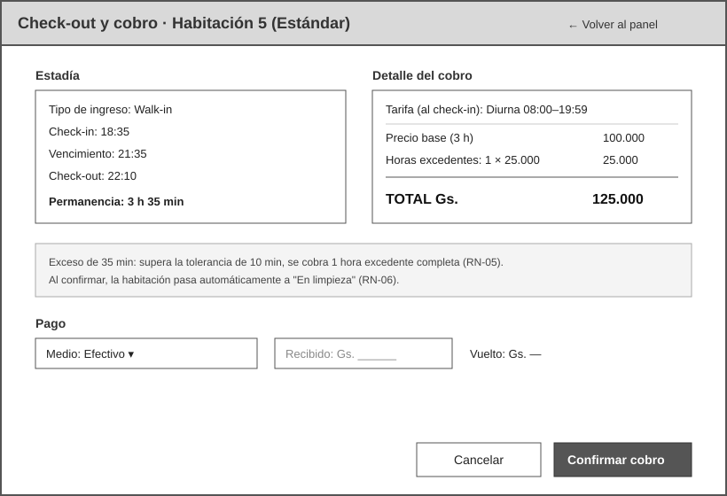

[← Volver al inicio](index.md)

# Entrega 2 · Análisis

> *Qué debe hacer el sistema, desde la perspectiva del negocio y del usuario.*

Este documento parte de la [Conceptualización](conceptualizacion.md) y respeta su alcance y su glosario (Habitación, Reserva, Check-in, Check-out, Walk-in, Tarifa por franja horaria, Estado de habitación). Quedan fuera, igual que en la Entrega 1, los pagos en línea, la app móvil para clientes, la facturación electrónica y la gestión de múltiples sucursales.

Para que el panel distinga las habitaciones que están "apartadas" para una llegada próxima, al conjunto de **estados de habitación** del glosario (libre, ocupada, en limpieza) se le suma **reservada**: la habitación tiene una reserva cuya hora prevista empieza dentro de la próxima hora.

---

## 1. Requisitos funcionales

| ID | Requisito | Prioridad |
|---|---|---|
| RF-01 | El sistema debe permitir al Encargado dar de alta, modificar y dar de baja habitaciones, indicando su número y su tipo de habitación. | Alta |
| RF-02 | El sistema debe permitir mantener el estado de cada habitación (libre, ocupada, en limpieza, reservada), actualizándolo automáticamente con cada reserva, check-in y check-out. | Alta |
| RF-03 | El sistema debe permitir al Encargado registrar y modificar las tarifas por franja horaria de cada tipo de habitación (horario de la franja, horas incluidas, precio base y precio por hora excedente). | Alta |
| RF-04 | El sistema debe permitir registrar una reserva anticipada indicando habitación, fecha y hora prevista, duración prevista y un nombre o alias con un teléfono de contacto. | Alta |
| RF-05 | El sistema debe permitir cancelar una reserva de forma manual y debe cancelar automáticamente las reservas sin check-in pasada la tolerancia definida. | Media |
| RF-06 | El sistema debe permitir registrar el check-in de un cliente con reserva, vinculando la estadía con esa reserva. | Alta |
| RF-07 | El sistema debe permitir registrar el check-in de un cliente walk-in sin solicitar datos personales. | Alta |
| RF-08 | El sistema debe permitir registrar el check-out de una estadía calculando automáticamente el monto a cobrar según el tiempo de permanencia y la tarifa vigente al momento del check-in. | Alta |
| RF-09 | El sistema debe permitir que, tras el check-out, la habitación quede en "en limpieza" y que el personal la libere cuando la limpieza termine. | Alta |
| RF-10 | El sistema debe permitir consultar un panel con el estado de todas las habitaciones en tiempo real, mostrando la hora de vencimiento de las ocupadas y la hora de llegada de las reservadas. | Alta |
| RF-11 | El sistema debe permitir consultar el historial de ocupación de cada habitación (estadías con hora de check-in, check-out y monto cobrado), filtrando por rango de fechas. | Media |
| RF-12 | El sistema debe permitir el inicio de sesión de usuarios con rol Recepcionista o Encargado, y al Encargado gestionar las cuentas de usuario. | Alta |
| RF-13 | El sistema debe permitir al Encargado generar un reporte simple de ocupación e ingresos por día o por rango de fechas. | Media |
| RF-14 | El sistema debe permitir al Encargado anular un cobro registrado, dejando constancia del motivo y del usuario que lo anuló. | Baja |

---

## 2. Requisitos no funcionales

| ID | Requisito | Categoría |
|---|---|---|
| RNF-01 | El panel de habitaciones debe cargarse en menos de 2 segundos con hasta 30 habitaciones y refrescarse automáticamente al menos cada 15 segundos. | Rendimiento |
| RNF-02 | Las contraseñas deben almacenarse cifradas con un algoritmo de hash seguro (bcrypt) y la sesión debe cerrarse tras 30 minutos de inactividad. | Seguridad |
| RNF-03 | El walk-in no debe exigir ningún dato personal; la reserva debe pedir solo un nombre o alias y un teléfono, y esos datos solo deben ser visibles para usuarios autenticados del personal (nunca en reportes impresos ni en el panel general). | Privacidad / discreción |
| RNF-04 | Un recepcionista sin capacitación previa debe poder completar un check-in walk-in en no más de 3 clics desde el panel y en menos de 30 segundos. | Usabilidad |
| RNF-05 | El sistema debe estar disponible durante el horario de atención del motel (24 h) con una disponibilidad mínima del 99 % mensual, y contar con un respaldo automático diario de la base de datos. | Disponibilidad |
| RNF-06 | El sistema debe funcionar en los navegadores Chrome, Firefox y Edge actuales, y poder instalarse tanto en un hosting básico con PHP y MySQL como en una PC local de recepción. | Portabilidad |
| RNF-07 | El código debe organizarse siguiendo el patrón MVC de Laravel, de modo que un cambio en las tarifas o en las reglas de cobro afecte a un único módulo. | Mantenibilidad |

---

## 3. Modelo de casos de uso

**Actores:**

- **Recepcionista:** atiende al cliente en persona o por teléfono; registra reservas, check-in, check-out y libera habitaciones.
- **Encargado / Administrador:** hereda todos los casos de uso del Recepcionista y además administra habitaciones, tarifas, usuarios, reportes y anulaciones.
- **Temporizador del sistema:** actor secundario que dispara la cancelación automática de reservas vencidas.

El **cliente no usa el sistema directamente**: la reserva la carga recepción cuando el cliente llama o se presenta.

**Diagrama de casos de uso:**

*Fuente: [`diagramas/casos-de-uso.mmd`](https://github.com/davvidmzs-1/proyecto-ingsw/blob/main/diagramas/casos-de-uso.mmd)*

**Especificación de casos de uso principales:**

### CU-01 · Registrar reserva

- **Actor(es):** Recepcionista (principal). Cliente como actor externo que pide la reserva por teléfono o en persona.
- **Precondición:** el recepcionista inició sesión; existe al menos una habitación activa con tarifas cargadas.
- **Flujo principal:**
  1. El recepcionista elige "Nueva reserva" en el panel.
  2. El sistema solicita fecha y hora prevista, duración prevista y tipo de habitación.
  3. El recepcionista carga los datos que indica el cliente.
  4. El sistema muestra las habitaciones disponibles en esa franja, sin superposición con otras reservas ni estadías (RN-02).
  5. El recepcionista elige una habitación y carga un nombre o alias y un teléfono de contacto.
  6. El sistema valida los datos y registra la reserva en estado "pendiente".
  7. El sistema muestra la confirmación con la tolerancia de llegada (RN-03).
- **Flujos alternativos:**
  - 4a. No hay habitaciones disponibles en ese horario: el sistema lo informa y ofrece horarios cercanos; el recepcionista cambia el horario o termina el caso de uso.
  - 6a. Falta el alias o el teléfono: el sistema marca el campo y no registra la reserva hasta completarlo.
  - 6b. Otro recepcionista tomó la habitación en el mismo instante: el sistema rechaza la operación y vuelve al paso 4.
- **Postcondición:** la reserva queda registrada y la habitación aparece como "reservada" en el panel desde una hora antes de la llegada prevista.

### CU-02 · Registrar check-in (con reserva o walk-in)

- **Actor(es):** Recepcionista.
- **Precondición:** el recepcionista inició sesión; la habitación elegida está libre o tiene una reserva a nombre del cliente que llega.
- **Flujo principal (walk-in):**
  1. El recepcionista selecciona una habitación libre en el panel y elige "Check-in".
  2. El sistema abre el formulario con tipo de ingreso "walk-in" y sugiere la franja horaria según la hora actual.
  3. El recepcionista confirma la franja, sin cargar datos personales (RN-08).
  4. El sistema verifica que la habitación siga libre y que la estadía no choque con una reserva próxima (RN-01).
  5. El sistema registra la estadía con la hora de check-in, la tarifa vigente y la hora de vencimiento.
  6. El sistema cambia la habitación a "ocupada" y actualiza el panel.
- **Flujos alternativos:**
  - 1a. **Check-in con reserva:** el recepcionista selecciona la habitación "reservada" (o busca la reserva por alias o teléfono); el sistema precarga la reserva y, al confirmar, la marca como "cumplida" y la vincula con la estadía. Sigue en el paso 4.
  - 4a. La habitación cambió de estado (otro usuario la ocupó o tiene una reserva que se superpone): el sistema rechaza el check-in y pide elegir otra habitación.
  - 4b. La reserva ya fue cancelada por superar la tolerancia (RN-03): el sistema lo informa y ofrece registrar el ingreso como walk-in si hay habitaciones libres.
- **Postcondición:** existe una estadía abierta asociada a la habitación, que figura como "ocupada" con su hora de vencimiento.

### CU-03 · Registrar check-out y cobro

- **Actor(es):** Recepcionista.
- **Precondición:** la habitación está "ocupada" con una estadía abierta.
- **Flujo principal:**
  1. El recepcionista selecciona la habitación ocupada y elige "Check-out".
  2. El sistema registra la hora de check-out y calcula el tiempo de permanencia.
  3. El sistema calcula el monto (include "Calcular monto a cobrar"): precio base de la franja más las horas excedentes, según la tarifa vigente al momento del check-in (RN-04, RN-05).
  4. El sistema muestra el detalle del cobro.
  5. El recepcionista cobra en efectivo y confirma.
  6. El sistema registra el cobro, cierra la estadía y pasa la habitación a "en limpieza" (RN-06).
  7. El sistema actualiza el panel.
- **Flujos alternativos:**
  - 4a. La permanencia no supera las horas incluidas más la tolerancia: el monto es solo el precio base.
  - 5a. El recepcionista cancela antes de confirmar: no se registra el cobro y la habitación sigue "ocupada".
  - 5b. El recepcionista detecta un error en el cobro ya confirmado: debe pedirle al Encargado que lo anule (CU-13).
- **Postcondición:** la estadía queda cerrada con su cobro y la habitación en "en limpieza".

### CU-04 · Gestionar tarifas

- **Actor(es):** Encargado / Administrador.
- **Precondición:** el usuario inició sesión con rol Encargado (RN-07).
- **Flujo principal:**
  1. El encargado ingresa a "Tarifas".
  2. El sistema lista las tarifas vigentes agrupadas por tipo de habitación.
  3. El encargado elige agregar una tarifa o modificar una existente.
  4. El sistema solicita nombre de la franja, hora de inicio y fin, horas incluidas, precio base y precio por hora excedente.
  5. El encargado carga los datos y confirma.
  6. El sistema valida que las franjas del mismo tipo de habitación no se superpongan y que los precios sean mayores a cero.
  7. El sistema guarda la tarifa con fecha "vigente desde" igual al momento de la confirmación.
- **Flujos alternativos:**
  - 6a. La franja se superpone con otra del mismo tipo: el sistema muestra el conflicto y no guarda los cambios.
  - 3a. El encargado da de baja una tarifa: el sistema la marca como no vigente sin borrarla, para no alterar estadías anteriores.
- **Postcondición:** la nueva tarifa se aplica a los check-in posteriores; las estadías abiertas conservan la tarifa con la que ingresaron (RN-04).

### CU-05 · Consultar panel de habitaciones

- **Actor(es):** Recepcionista (y Encargado por herencia).
- **Precondición:** el usuario inició sesión.
- **Flujo principal:**
  1. El usuario abre el panel (es la pantalla de inicio después del login).
  2. El sistema muestra una grilla con todas las habitaciones, su tipo y su estado: libre, ocupada, en limpieza o reservada.
  3. Para las ocupadas, el sistema muestra la hora de vencimiento; para las reservadas, la hora de llegada y el alias.
  4. El sistema muestra un resumen con la cantidad de habitaciones en cada estado.
  5. El sistema refresca la grilla automáticamente (RNF-01).
  6. El usuario puede elegir una habitación para iniciar check-in, check-out o liberación.
- **Flujos alternativos:**
  - 2a. El usuario filtra por estado: el sistema muestra solo las habitaciones de ese estado.
  - 3a. Una estadía superó su hora de vencimiento: el sistema la resalta como "vencida".
  - 5a. Se pierde la conexión con el servidor: el sistema muestra un aviso de "datos desactualizados" hasta reconectar.
- **Postcondición:** no se modifican datos; el usuario conoce el estado actual del motel.

### Otros casos de uso

| ID | Caso de uso | Actor | Descripción breve |
|---|---|---|---|
| CU-06 | Gestionar habitaciones | Encargado | Alta, modificación y baja lógica de habitaciones y tipos de habitación. |
| CU-07 | Cancelar reserva | Recepcionista / Temporizador | Cancelación manual a pedido del cliente o automática al vencer la tolerancia; libera la habitación. |
| CU-08 | Liberar habitación (fin de limpieza) | Recepcionista | Pasa una habitación de "en limpieza" a "libre" cuando el personal termina la limpieza. |
| CU-09 | Consultar historial de ocupación | Recepcionista / Encargado | Lista las estadías de una habitación en un rango de fechas, con horarios y montos. |
| CU-10 | Iniciar sesión | Recepcionista / Encargado | Autenticación con usuario y contraseña; el menú se adapta al rol. |
| CU-11 | Gestionar usuarios | Encargado | Alta, baja y cambio de rol de las cuentas del personal. |
| CU-12 | Generar reporte de ocupación e ingresos | Encargado | Totales de estadías, horas ocupadas e ingresos por día o rango, sin datos personales. |
| CU-13 | Anular cobro | Encargado | Anula un cobro registrado indicando el motivo; queda constancia del usuario. |

---

## 4. Modelo de dominio

**Diagrama de clases conceptual:**

*Fuente: [`diagramas/modelo-dominio.mmd`](https://github.com/davvidmzs-1/proyecto-ingsw/blob/main/diagramas/modelo-dominio.mmd)*

El modelo representa los conceptos del negocio, no la base de datos: no tiene métodos, tipos de dato ni claves foráneas.

- **TipoHabitación – Habitación (1 a 1..\*)**: cada habitación pertenece a un único tipo (por ejemplo, Estándar o Suite) y cada tipo agrupa al menos una habitación. El **estado** de la habitación es uno de los estados del glosario.
- **TipoHabitación – Tarifa (1 a 1..\*)**: los precios no se definen por habitación sino por tipo; cada tipo tiene una o más **tarifas por franja horaria** (por ejemplo, diurna y nocturna), cada una con sus horas incluidas, su precio base y su precio por hora excedente.
- **Cliente – Reserva (1 a 1..\*)**: el cliente solo existe cuando hay una reserva y guarda datos mínimos (nombre o alias y teléfono). Un cliente puede tener varias reservas a lo largo del tiempo.
- **Habitación – Reserva (1 a 0..\*)** y **Habitación – Estadía (1 a 0..\*)**: una habitación acumula reservas y estadías en su historial; cada reserva y cada estadía corresponde a una sola habitación.
- **Reserva – Estadía (0..1 a 0..1)**: una reserva puede concretarse en una estadía (check-in con reserva) o no (cancelada). Una estadía walk-in no tiene reserva ni cliente asociado, por eso el walk-in no deja datos personales.
- **Tarifa – Estadía (1 a 0..\*)**: cada estadía guarda la tarifa vigente al momento del check-in, que es la que se usa para calcular el cobro aunque luego cambie.
- **Estadía – Cobro (1 a 0..\*)**: una estadía abierta todavía no tiene cobro; al hacer check-out se genera uno. Si el Encargado lo anula, se registra uno nuevo, de modo que a lo sumo un cobro por estadía queda no anulado.
- **Usuario – Reserva / Estadía / Cobro (1 a 0..\*)**: cada operación queda asociada al usuario del personal que la registró, lo que permite auditar quién hizo qué. El **rol** del usuario (Recepcionista o Encargado) determina qué casos de uso puede ejecutar.

---

## 5. Diagramas de comportamiento

**Diagrama de secuencia — Check-in walk-in:**

*Fuente: [`diagramas/secuencia-checkin-walkin.mmd`](https://github.com/davvidmzs-1/proyecto-ingsw/blob/main/diagramas/secuencia-checkin-walkin.mmd)*

El recepcionista elige una habitación libre desde el panel y el sistema le sugiere la franja horaria según la hora actual, sin pedir datos personales. Antes de crear la estadía se vuelve a verificar el estado de la habitación (puede haber cambiado mientras se completaba el formulario); si sigue libre, se crea la estadía con su hora de vencimiento y la habitación pasa a "ocupada". Si no, se rechaza el ingreso aplicando la RN-01.

**Diagrama de actividad — Check-out y cobro:**

*Fuente: [`diagramas/actividad-checkout.mmd`](https://github.com/davvidmzs-1/proyecto-ingsw/blob/main/diagramas/actividad-checkout.mmd)*

Al registrar el check-out, el sistema toma la tarifa con la que ingresó el cliente y compara el tiempo de permanencia con las horas incluidas más la tolerancia. Si se excedió, suma las horas excedentes redondeadas hacia arriba. Con el pago confirmado se registra el cobro, se cierra la estadía y la habitación pasa obligatoriamente a "en limpieza"; si el recepcionista cancela, la habitación sigue ocupada.

---

## 6. Prototipo de interfaz (mockups)

Wireframes de baja fidelidad: solo grises y cajas, para validar distribución y flujo con el encargado del motel antes de definir el diseño visual.

**Pantalla — Panel de habitaciones:**

Es la pantalla de inicio. Cada tarjeta es una habitación con su número, tipo y estado; el estado se distingue por relleno (y en el sistema real también por color) y por una etiqueta en texto. Las ocupadas muestran la hora de vencimiento y se resaltan como "vencida" cuando la superan; las reservadas, la hora de llegada y el alias. Cada tarjeta ofrece solo la acción que corresponde a su estado (check-in, check-out, marcar como libre), y arriba hay un resumen por estado, un filtro y el acceso a "Nueva reserva".

**Pantalla — Formulario de check-in:**

Se abre desde una habitación libre o reservada. El recepcionista elige el tipo de ingreso: en walk-in no se piden datos personales; con reserva, se busca por alias o teléfono y los datos se muestran en solo lectura. La franja se sugiere según la hora actual y el resumen muestra la hora de vencimiento antes de confirmar.

**Pantalla — Check-out y cobro:**

Muestra los horarios de la estadía, la tarifa aplicada (la del check-in) y el desglose del monto: precio base más horas excedentes. Una nota explica por qué se cobró el excedente y avisa que la habitación pasará a "en limpieza". El recepcionista carga el monto recibido, el sistema calcula el vuelto y se confirma el cobro.

---

## 7. Reglas del negocio

| ID | Regla |
|---|---|
| RN-01 | Una habitación ocupada o en limpieza no puede asignarse a otro cliente; una habitación con una reserva no admite un walk-in cuya duración incluida se superponga con el horario reservado. |
| RN-02 | No se aceptan reservas superpuestas para la misma habitación: entre la hora prevista y el fin de la duración prevista no puede haber otra reserva ni una estadía abierta. |
| RN-03 | Una reserva sin check-in pasados 30 minutos de la hora prevista se cancela automáticamente y libera la habitación. |
| RN-04 | El cobro se calcula con la tarifa vigente al momento del check-in, aunque el Encargado la modifique durante la estadía. |
| RN-05 | Monto = precio base de la franja + (horas excedentes × precio por hora excedente). Hay una tolerancia de 10 minutos sobre las horas incluidas; superada la tolerancia, cada fracción de hora excedente se cobra como hora completa. |
| RN-06 | Después del check-out la habitación pasa obligatoriamente a "en limpieza" y solo vuelve a "libre" cuando el personal la libera manualmente. |
| RN-07 | Solo el Encargado puede crear o modificar tarifas, gestionar habitaciones y usuarios, generar reportes y anular cobros. |
| RN-08 | El walk-in no requiere datos personales; la reserva solo admite un nombre o alias y un teléfono, visibles únicamente para el personal autenticado. |
| RN-09 | Un cobro confirmado no se edita ni se borra: solo puede anularse, con motivo obligatorio y registro del usuario que lo anuló. |
| RN-10 | Las franjas horarias de un mismo tipo de habitación no pueden superponerse, de modo que a cada hora del día le corresponda una única tarifa. |

---

## 8. Matriz de trazabilidad

| Requisito | Caso(s) de uso relacionado(s) |
|---|---|
| RF-01 | CU-06 |
| RF-02 | CU-02, CU-03, CU-05, CU-08 |
| RF-03 | CU-04 |
| RF-04 | CU-01 |
| RF-05 | CU-07 |
| RF-06 | CU-02 |
| RF-07 | CU-02 |
| RF-08 | CU-03 |
| RF-09 | CU-03, CU-08 |
| RF-10 | CU-05 |
| RF-11 | CU-09 |
| RF-12 | CU-10, CU-11 |
| RF-13 | CU-12 |
| RF-14 | CU-13 |

Los 14 requisitos funcionales están cubiertos por al menos un caso de uso, y cada uno de los 13 casos de uso responde a al menos un requisito.

---

[← Anterior: Conceptualización](conceptualizacion.md) · [Siguiente: Diseño →](diseno.md)
