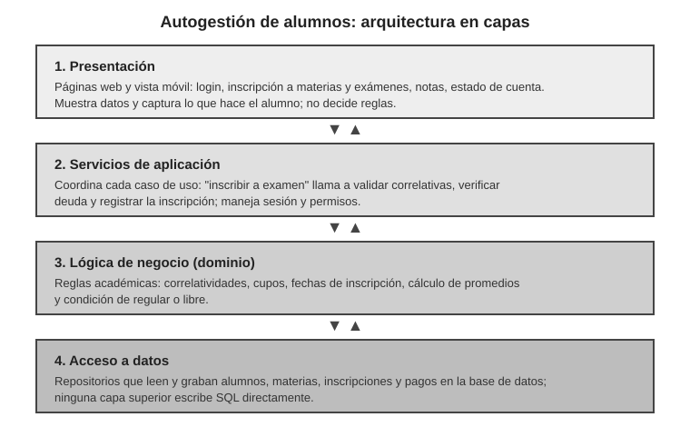
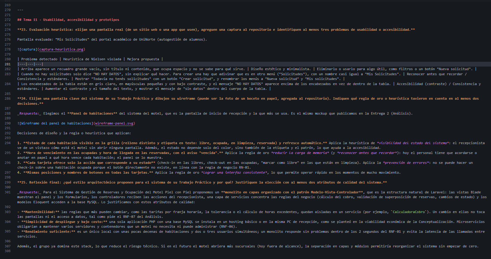
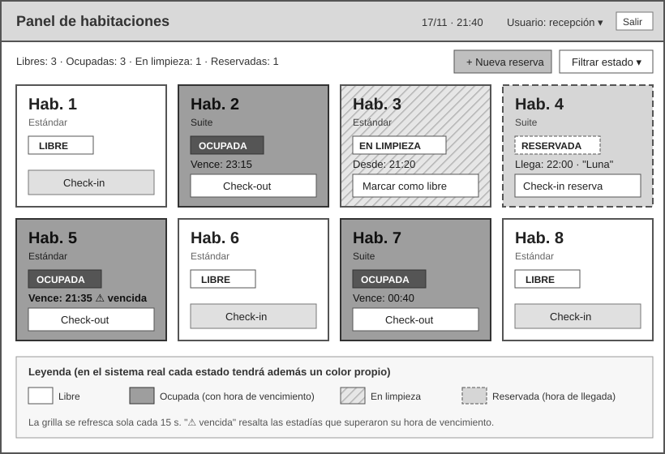

# Respuestas — Ejercitario Unidad 05

---

## Tema 1 · El diseño en la ingeniería de software

**1. Explica con tus palabras la diferencia entre diseño conceptual y diseño técnico (detallado). Da un ejemplo de una decisión de cada tipo para un sistema de gestión de una biblioteca.**

_Respuesta:_ El diseño conceptual describe la solución en términos que entiende el cliente: qué partes tiene el sistema, qué hace cada una y cómo se relacionan, sin entrar en cómo se van a programar. El diseño técnico o detallado toma ese esquema y lo baja a decisiones concretas de construcción: tecnologías, estructura de clases, tablas, algoritmos e interfaces entre componentes, pensado para quienes van a codificar. En una biblioteca, una decisión conceptual sería "el sistema tendrá un módulo de préstamos que controla qué socio tiene cada ejemplar y cuándo debe devolverlo". Una decisión técnica sería "la tabla `prestamos` tendrá un índice por `fecha_vencimiento` y un proceso programado cada noche consultará los vencidos para generar los avisos".

**2. Completa el siguiente cuadro sobre los elementos del modelo de diseño.**

| Elemento del diseño | ¿Qué define? | Ejemplo en un sistema de inscripciones |
|---|---|---|
| Diseño de datos | Las estructuras de información que maneja el sistema, sus atributos y relaciones, y cómo se guardan. | Entidades Alumno, Materia, Comisión e Inscripción; una inscripción vincula un alumno con una comisión en un período lectivo. |
| Diseño arquitectónico | La estructura general: los grandes componentes, cómo se comunican y el estilo que se adopta. | Aplicación web en capas (presentación, servicios, dominio y datos) con una base relacional central. |
| Diseño de interfaces | Cómo se comunica el sistema con los usuarios, con otros sistemas y entre sus propios componentes. | Pantalla de inscripción con buscador de materias, y un servicio que consulta al sistema de tesorería si el alumno tiene deuda. |
| Diseño de componentes | El funcionamiento interno de cada módulo: sus responsabilidades, algoritmos y datos locales. | El componente "Validador de correlativas" recibe alumno y materia, revisa las materias aprobadas y devuelve si puede inscribirse y por qué. |

---

## Tema 2 · Conceptos fundamentales de diseño

**3. Ejercicio de relación** (completen con el número que corresponda a cada letra):

| Concepto | Número |
|---|---|
| A. Abstracción | 4 |
| B. Refinamiento progresivo | 6 |
| C. Ocultamiento de información | 2 |
| D. Separación de intereses | 5 |
| E. Patrón | 3 |
| F. Refactorización | 1 |

1. Mejorar la estructura interna sin cambiar el comportamiento externo.
2. Cada módulo esconde sus decisiones internas y solo expone su interfaz.
3. Solución probada a un problema de diseño que se repite en un contexto dado.
4. Concentrarse en lo esencial e ignorar los detalles irrelevantes en ese nivel.
5. Dividir un problema en partes que se puedan resolver y modificar de forma independiente.
6. Agregar detalle en pasos sucesivos, partiendo de una descripción general.

**4. Aplica refinamiento progresivo a la tarea "Registrar una venta en un comercio": escribí al menos tres niveles de detalle, refinando en el tercer nivel uno de los pasos del segundo.**

_Respuesta:_

**Nivel 1 (visión general):**
- Registrar una venta en un comercio.

**Nivel 2 (pasos principales):**
1. Identificar al cajero y abrir una venta nueva.
2. Cargar los productos que lleva el cliente.
3. Calcular el total de la venta.
4. Cobrar al cliente.
5. Emitir el comprobante y actualizar el stock.

**Nivel 3 (refinamiento del paso 2 "Cargar los productos"):**
- 2.1. Leer el código de barras del producto (o buscarlo por nombre si no tiene código).
- 2.2. Buscar el producto en el catálogo; si no existe, avisar al cajero y volver a 2.1.
- 2.3. Pedir la cantidad (por defecto 1) y verificar que haya stock suficiente.
- 2.4. Obtener el precio vigente y aplicar el descuento si el producto está en promoción.
- 2.5. Agregar la línea (producto, cantidad, precio unitario, subtotal) al detalle de la venta.
- 2.6. Repetir desde 2.1 hasta que el cajero indique que no hay más productos.

Se podría seguir refinando, por ejemplo, el paso 2.4 en las reglas concretas de cada tipo de promoción (2x1, porcentaje, precio fijo).

---

## Tema 3 · Descomposición y modularidad

**5. Explica por qué no conviene dividir un sistema ni en muy pocos ni en demasiados módulos. ¿Qué costos aumentan en cada extremo?**

_Respuesta:_ Dividir un sistema en módulos baja el costo de desarrollar cada parte, porque cada una es más chica y fácil de entender, pero sube el costo de integrarlas, porque hay más interfaces que diseñar, probar y mantener. Con muy pocos módulos, cada uno es enorme y mezcla responsabilidades: cuesta entenderlo, varias personas terminan tocando el mismo código y cualquier cambio tiene efectos inesperados; el costo que se dispara es el de desarrollo y mantenimiento de cada módulo. Con demasiados módulos pasa lo contrario: cada pieza es trivial, pero una funcionalidad simple atraviesa diez módulos, hay muchas llamadas e interfaces y el costo que crece es el de integración y coordinación. Lo conveniente es una zona intermedia donde la suma de ambos costos sea mínima, con módulos que agrupen una responsabilidad completa.

**6. Para un sistema de gestión de un consultorio médico, propone dos descomposiciones distintas e indica qué módulos tendría cada una.**

| Estrategia | Módulos propuestos |
|---|---|
| Por capas | **Presentación:** pantallas de agenda, ficha del paciente, consulta y caja. **Servicios de aplicación:** coordinan cada operación (dar turno, registrar consulta, cobrar). **Dominio:** reglas del consultorio (duración de turnos, disponibilidad del médico, coberturas de seguro). **Acceso a datos:** repositorios de pacientes, turnos, historias clínicas y pagos. |
| Por dominio | **Pacientes:** alta y datos de contacto y cobertura. **Turnos:** agenda de cada médico, reservas y cancelaciones. **Historia clínica:** consultas, diagnósticos, recetas y estudios. **Facturación y cobros:** aranceles, pagos y liquidación con seguros. **Usuarios y permisos:** médicos, secretarias y lo que puede ver cada uno. |

---

## Tema 4 · Cohesión y acoplamiento

**7. Indica el tipo de cohesión de cada módulo (coincidental, lógica, temporal, procedimental, comunicacional, secuencial o funcional) y justifica brevemente.**

| Módulo | Tipo de cohesión y justificación |
|---|---|
| a) "Utilidades": FormatearFecha, EnviarCorreo y CalcularIVA. | **Coincidental.** Las tres operaciones no tienen nada en común: están juntas solo porque "no tenían otro lugar", y ninguna usa datos de las otras. |
| b) "IniciarSistema": abre la conexión a la base, carga la configuración y borra archivos temporales. | **Temporal.** Las tareas no están relacionadas entre sí; lo único que las une es que se ejecutan en el mismo momento, al arrancar. |
| c) "CalcularPromedioAlumno": obtiene las notas de un alumno y devuelve su promedio. | **Funcional.** Todo lo que hace el módulo contribuye a una única tarea bien definida: obtener el promedio de un alumno. Es el nivel ideal. |
| d) "ProcesarOperacion": recibe un código y, según su valor, imprime, guarda o elimina un registro. | **Lógica.** Agrupa acciones de la misma "categoría" (operar sobre un registro) que son distintas entre sí, y un parámetro externo elige cuál ejecutar. |
| e) Lee un registro, lo valida y, con el registro ya validado, calcula su total. | **Secuencial.** Los pasos forman una cadena en la que la salida de uno (el registro leído, luego validado) es la entrada del siguiente. |

**8. Indica el tipo de acoplamiento en cada caso (de datos, por estampado, de control, externo, común o de contenido).**

| Situación | Tipo de acoplamiento |
|---|---|
| a) El módulo A llama a B pasándole solo el idAlumno. | **De datos:** B recibe únicamente el dato simple que necesita. Es el más deseable. |
| b) A le pasa a B una bandera modo = "imprimir" / "guardar" que decide qué hace B. | **De control:** A dirige la lógica interna de B mediante una bandera, por lo que A tiene que conocer cómo funciona B por dentro. |
| c) Varios módulos leen y modifican la variable global TotalVentas. | **Común:** comparten un dato global; un cambio de cualquiera afecta a todos y es difícil rastrear quién lo modificó. |
| d) A modifica directamente un atributo privado de B. | **De contenido:** A invade el interior de B saltándose su interfaz. Es el peor tipo de acoplamiento. |
| e) A le pasa a B el objeto Alumno completo, aunque B solo usa la fecha de nacimiento. | **Por estampado:** se pasa una estructura completa cuando solo se usa una parte, así que B queda atado a la forma de Alumno. |

**9. Explica por qué la alta cohesión y el bajo acoplamiento suelen ir de la mano. Da un ejemplo.**

_Respuesta:_ Cuando un módulo tiene alta cohesión, todo lo que necesita para cumplir su única responsabilidad está adentro de él, así que casi no depende de otros: con poco intercambio de datos simples le alcanza, y eso es bajo acoplamiento. En cambio, si las responsabilidades están desparramadas (baja cohesión), cada módulo necesita pedirle cosas a los demás o tocar sus datos para completar una tarea, y las dependencias se multiplican. Por eso mejorar una propiedad suele mejorar la otra. Por ejemplo, en nuestro sistema del motel, si todo el cálculo del cobro (tarifa, horas incluidas, tolerancia y excedentes) está en un único componente `CalculadoraCobro`, el check-out solo le pasa la estadía y recibe un monto. Si en cambio el cálculo estuviera repartido entre la pantalla, el controlador y la clase de habitación, los tres tendrían que conocerse entre sí y cambiar la regla de tolerancia obligaría a tocarlos a todos.

---

## Tema 5 · Arquitectura y estilos arquitectónicos clásicos

**10. Ejercicio de relación** (completen con el número que corresponda a cada letra):

| Estilo arquitectónico | Número |
|---|---|
| A. En capas | 5 |
| B. Cliente-servidor | 4 |
| C. Centrado en datos (repositorio) | 2 |
| D. Tuberías y filtros | 1 |
| E. Modelo-Vista-Controlador | 3 |

1. Un compilador: análisis léxico → sintáctico → semántico → generación de código.
2. Un entorno de desarrollo donde editor, depurador y analizador comparten un modelo central del proyecto.
3. Una aplicación web donde un controlador recibe el pedido, actualiza el modelo y elige qué vista mostrar.
4. Un cajero automático que consulta al servidor del banco para cada operación.
5. Un sistema contable organizado en presentación, lógica de negocio y acceso a datos.

**11. Dibujá o describí la arquitectura en capas de un sistema que conozcas (de tu trabajo, de la universidad o una app de uso diario), indicando la responsabilidad de cada capa. Si lo dibujan, agreguen la imagen al repositorio y enlácenla en la respuesta.**

_Respuesta:_ Elegimos el sistema de autogestión de alumnos de la universidad, que usamos todos los semestres. Lo describimos en cuatro capas, donde cada una solo se comunica con la de abajo:

1. **Presentación:** las páginas web (y su versión para celular) donde el alumno inicia sesión, se inscribe a materias y exámenes, y consulta notas y estado de cuenta. Solo muestra información y captura acciones; no decide si una inscripción es válida.
2. **Servicios de aplicación:** organiza cada caso de uso. Por ejemplo, "inscribirse a un examen" pide validar correlativas, verificar que no haya deuda y, si todo está bien, registrar la inscripción. También controla la sesión y los permisos.
3. **Lógica de negocio (dominio):** contiene las reglas académicas propiamente dichas: correlatividades, cupos por comisión, fechas habilitadas, cálculo del promedio y condición de regular o libre.
4. **Acceso a datos:** repositorios que leen y graban alumnos, materias, inscripciones y pagos en la base de datos. Ninguna capa de arriba escribe consultas SQL.

La ventaja de esta separación es que si la universidad cambia la regla de correlativas solo se toca la capa de dominio, y si se rediseñan las pantallas no hace falta tocar las reglas.

---

## Tema 6 · Estilos actuales y estrategia de selección

**12. Completa el siguiente cuadro comparativo.**

| Aspecto | Monolito modular | Microservicios |
|---|---|---|
| Despliegue | Una sola unidad desplegable: se sube una aplicación y una base de datos. Cualquier cambio implica redesplegar todo, pero el proceso es simple. | Cada servicio se despliega por separado y con su propio ritmo; hace falta automatización (CI/CD, contenedores) para manejar muchos despliegues. |
| Escalado | Se escala la aplicación completa (más instancias o un servidor más grande), aunque solo una parte tenga más carga. | Se escala solo el servicio que lo necesita (por ejemplo, el de pagos en un pico), aprovechando mejor los recursos. |
| Complejidad operativa | Baja: un proceso, un log, transacciones locales y depuración sencilla. | Alta: red entre servicios, fallas parciales, monitoreo distribuido, consistencia eventual y versiones de API. |
| ¿Cuándo conviene? | Equipos chicos, productos nuevos o dominios acotados donde todavía se está aprendiendo el negocio. Es el punto de partida recomendado. | Organizaciones con varios equipos autónomos, dominios grandes y bien entendidos, y necesidades de escalar partes de forma independiente. |

**13. Una empresa nueva con tres desarrolladores quiere empezar su producto directamente con quince microservicios. ¿Qué le recomendarías y por qué?**

_Respuesta:_ Le recomendaríamos empezar con un monolito modular y no con microservicios. Con tres personas, quince servicios significa que cada desarrollador tiene que mantener cinco despliegues, con sus pipelines, bases de datos, monitoreo y contratos de API, y el tiempo se va en infraestructura en lugar de en el producto. Además, una empresa nueva todavía no conoce bien su dominio: si los límites entre servicios están mal elegidos, corregirlos entre servicios separados cuesta mucho más que mover código entre módulos de un mismo proyecto. Lo sensato es armar un monolito con módulos bien separados por dominio y bajo acoplamiento, y más adelante, si el producto crece y aparece una parte con necesidades claras de escalado o un equipo propio, extraer esa parte como servicio.

**14. Para cada escenario, indica el atributo de calidad prioritario y un estilo arquitectónico que lo favorezca.**

| Escenario | Atributo prioritario | Estilo que lo favorece |
|---|---|---|
| Plataforma de venta de entradas con picos enormes de demanda al abrir la venta. | Escalabilidad (y disponibilidad bajo carga). | Microservicios con una arquitectura orientada a eventos y colas, para escalar solo el servicio de compra y absorber los picos en una fila virtual. |
| Sistema bancario de transferencias entre cuentas. | Seguridad e integridad de los datos (consistencia de las transacciones). | Cliente-servidor en capas, con una base centralizada transaccional (centrado en datos) que garantice que el débito y el crédito ocurren juntos o no ocurren. |
| Sistema académico cuyas reglas de inscripción cambian cada semestre. | Mantenibilidad (modificabilidad). | Arquitectura en capas (o monolito modular) que aísle las reglas de negocio en la capa de dominio, para cambiarlas sin tocar pantallas ni datos. |

---

## Tema 7 · Características de un buen diseño

**15. Menciona las tres directrices de calidad de Pressman para un buen diseño y explica una de ellas con un ejemplo propio.**

_Respuesta:_ Según Pressman, un buen diseño debe:

1. **Implementar todos los requisitos** explícitos que quedaron en el modelo de análisis y también los requisitos implícitos que espera el cliente aunque no los haya dicho.
2. **Ser una guía legible y comprensible** para quienes van a escribir el código y para quienes después van a probar y mantener el software.
3. **Dar una imagen completa del software**, abarcando los datos, las funciones y el comportamiento desde la perspectiva de la implementación.

Explicamos la primera con nuestro sistema del motel. El requisito explícito es "calcular automáticamente el monto en el check-out". Pero el encargado también espera, sin haberlo dicho, que si cambia una tarifa a mitad de la noche no se modifique lo que pagan las habitaciones que ya estaban ocupadas. Un buen diseño tiene que contemplar ese requisito implícito, por ejemplo guardando en cada estadía la tarifa con la que ingresó, en lugar de buscar la tarifa vigente al momento del cobro.

**16. Ejercicio de relación** (completen con el número que corresponda a cada letra):

| Síntoma | Número |
|---|---|
| A. Rigidez | 3 |
| B. Fragilidad | 4 |
| C. Inmovilidad | 2 |
| D. Repetición innecesaria | 1 |

1. La misma lógica está copiada en varios lugares del sistema.
2. Cuesta reutilizar un componente porque arrastra demasiadas dependencias.
3. Un cambio simple obliga a modificar muchos módulos.
4. Un cambio rompe partes que aparentemente no tenían relación.

---

## Tema 8 · Principios SOLID

**17. Completa el cuadro con el nombre de cada principio y lo que propone, en una oración.**

| Letra | Principio | ¿Qué propone? |
|---|---|---|
| S | Responsabilidad única (Single Responsibility) | Una clase debe tener un solo motivo para cambiar, es decir, encargarse de una única responsabilidad. |
| O | Abierto/cerrado (Open/Closed) | Las clases deben poder extenderse con comportamiento nuevo sin tener que modificar su código ya probado. |
| L | Sustitución de Liskov (Liskov Substitution) | Un objeto de una subclase debe poder usarse en lugar de su clase base sin que el programa deje de funcionar correctamente. |
| I | Segregación de interfaces (Interface Segregation) | Es mejor tener varias interfaces chicas y específicas que una grande que obligue a implementar métodos que no se usan. |
| D | Inversión de dependencias (Dependency Inversion) | Los módulos de alto nivel deben depender de abstracciones (interfaces) y no de implementaciones concretas de bajo nivel. |

**18. Analiza la siguiente clase: "ReporteVentas obtiene las ventas desde SQL Server, calcula los totales, arma un PDF y lo envía por correo". ¿Qué principio SOLID viola principalmente? Propone una mejor distribución de responsabilidades (nombres de clases o interfaces y qué hace cada una).**

_Respuesta:_ Viola principalmente el **principio de responsabilidad única (SRP)**: la clase tiene cuatro motivos distintos para cambiar (si cambia la base de datos, la forma de calcular totales, el formato del PDF o el servidor de correo). También viola el **principio de inversión de dependencias (DIP)**, porque la lógica del reporte depende directamente de SQL Server, una implementación concreta, y no se puede probar ni cambiar de motor sin tocarla. Proponemos esta distribución:

| Clase / interfaz | Responsabilidad |
|---|---|
| `VentaRepository` (interfaz) | Obtener las ventas de un período. Implementación concreta: `SqlServerVentaRepository`; mañana podría existir `MySqlVentaRepository` sin tocar nada más. |
| `CalculadoraTotales` | Recibir una lista de ventas y devolver los totales (por día, por vendedor, total general). No sabe de dónde salen las ventas ni cómo se muestran. |
| `GeneradorPdf` (interfaz) | Convertir los totales en un documento PDF. Implementación concreta con la biblioteca que se elija. |
| `Notificador` (interfaz) con implementación `EnviadorCorreo` | Enviar un archivo adjunto a los destinatarios. Podría agregarse otro canal sin modificar el reporte. |
| `ServicioReporteVentas` | Orquestar el proceso: pide las ventas al repositorio, las pasa a la calculadora, genera el PDF y lo envía. Recibe las cuatro dependencias por constructor como interfaces. |

Así cada clase cambia por un único motivo y el servicio depende solo de abstracciones, lo que además permite probarlo con implementaciones falsas.

---

## Tema 9 · Evaluación y validación del diseño

**19. Explica la diferencia entre una revisión técnica del diseño y una prueba del software. ¿Por qué conviene revisar el diseño antes de programar?**

_Respuesta:_ Una revisión técnica del diseño es una actividad estática: un grupo de personas lee y analiza los modelos (diagramas, especificaciones, interfaces) buscando errores, omisiones o inconsistencias, sin ejecutar nada. La prueba, en cambio, es dinámica: se ejecuta el software ya construido con datos concretos para ver si su comportamiento coincide con lo esperado. Conviene revisar el diseño antes de programar porque el costo de corregir un error crece mucho a medida que avanza el proyecto: cambiar una flecha en un diagrama lleva minutos, mientras que corregir la misma falla después de programada implica reescribir código, volver a probar y a veces migrar datos. Además, hay errores que las pruebas difícilmente detectan, como un requisito que ningún módulo cubre o un acoplamiento excesivo que va a complicar el mantenimiento.

**20. Completa la matriz de trazabilidad para un sistema de biblioteca, indicando qué elementos de diseño (módulos, clases, interfaces, pantallas) satisfacen cada requerimiento.**

| Req. | Descripción | Elementos de diseño que lo satisfacen |
|---|---|---|
| RF-01 | Registrar el préstamo de un libro a un socio. | Módulo Préstamos; clases `Prestamo`, `Socio`, `Ejemplar`; `ServicioPrestamos` (valida que el socio esté habilitado y el ejemplar disponible); `PrestamoRepository`; pantalla "Nuevo préstamo". |
| RF-02 | Avisar por correo al socio cuando vence un préstamo. | Tarea programada `VerificadorVencimientos` (diaria); interfaz `Notificador` con implementación `EnviadorCorreo`; plantilla del correo de aviso; `PrestamoRepository` (consulta de préstamos por vencer). |
| RF-03 | Buscar libros por título, autor o tema. | Módulo Catálogo; clases `Libro`, `Autor`, `Tema`; `ServicioBusqueda`; `LibroRepository` con búsqueda por texto; pantalla "Buscar en el catálogo" con filtros. |
| RNF-01 | Solo el personal de la biblioteca puede registrar préstamos. | Módulo Seguridad; clases `Usuario` y `Rol`; `ServicioAutenticacion`; middleware de autorización que protege `ServicioPrestamos` y la pantalla "Nuevo préstamo"; pantalla de login. |

---

## Tema 10 · Diseño de la interfaz de usuario

**21. Para cada regla de oro, da un ejemplo de una aplicación o sitio que la cumpla y otro que la viole.**

| Regla de oro | Ejemplo que la cumple | Ejemplo que la viola |
|---|---|---|
| Dar el control al usuario | Gmail: después de enviar o borrar un correo muestra "Deshacer" durante unos segundos, y el usuario decide si sigue o vuelve atrás. | Sitios de noticias con un video que arranca solo con sonido y una ventana emergente que no se puede cerrar hasta que termina la publicidad. |
| Reducir la carga de memoria | Las apps de delivery recuerdan la dirección y el último pedido, y muestran el estado del envío en pantalla en todo momento. | Formularios de trámites que piden en el paso 4 un número que solo aparecía en el paso 1, obligando a anotarlo o volver atrás. |
| Lograr una interfaz consistente | Las aplicaciones de Microsoft Office usan la misma cinta de opciones, los mismos íconos y los mismos atajos (Ctrl+G, Ctrl+Z) en Word, Excel y PowerPoint. | Sistemas armados por partes, donde en una pantalla "Guardar" está a la derecha en verde y en otra a la izquierda en rojo, y el mismo ícono significa cosas distintas. |

**22. Realiza el análisis previo al diseño de la interfaz para la aplicación de autogestión de alumnos de la universidad.**

| Aspecto | Descripción |
|---|---|
| Usuarios | Alumnos de grado de todas las carreras, de entre 18 y 50 años aproximadamente, con distinto nivel de manejo de tecnología. Muchos trabajan y estudian, usan la aplicación pocas veces por semestre (uso esporádico, con picos en las fechas de inscripción) y algunos pueden tener baja visión o usar lectores de pantalla. |
| Tareas principales | Iniciar sesión; inscribirse a materias y a exámenes finales; consultar notas, asistencia y calendario; ver el estado de cuenta y descargar boletas de pago; pedir constancias; leer avisos de la universidad. Las tareas críticas son las inscripciones, porque tienen fecha límite y cupos. |
| Entorno de uso | Mayormente desde el celular, con datos móviles o Wi-Fi de la facultad, muchas veces en el transporte o entre clases y con apuro. También desde PC en casa o en el trabajo. En los días de inscripción hay muchos accesos al mismo tiempo, así que la interfaz debe ser liviana y dar mensajes claros si el sistema está lento. |

---

## Tema 11 · Usabilidad, accesibilidad y prototipos

**23. Evaluación heurística: elijan una pantalla real (de un sitio web o una app que usen), agreguen una captura al repositorio e identifiquen al menos tres problemas de usabilidad o accesibilidad.**

Pantalla evaluada: "Mis Solicitudes" del portal académico de UniNorte (autogestión de alumnos).

| Problema detectado | Heurística de Nielsen violada | Mejora propuesta |
|---|---|---|
| Arriba aparece un recuadro grande vacío, sin título ni contenido, que ocupa espacio y no se sabe para qué sirve. | Diseño estético y minimalista. | Eliminarlo o usarlo para algo útil, como filtros o un botón "Nueva solicitud". |
| Cuando no hay solicitudes solo dice "NO HAY DATOS", sin explicar qué hacer. Para crear una hay que adivinar que es en otro menú ("Solicitudes"), con un nombre casi igual a "Mis Solicitudes". | Reconocer antes que recordar / Consistencia y estándares. | Mostrar "Todavía no tenés solicitudes" con un botón "Crear solicitud", y renombrar los menús a "Nueva solicitud" y "Mis solicitudes". |
| Los encabezados de la tabla están en gris claro, en mayúsculas pequeñas y con bajo contraste, y el mensaje "NO HAY DATOS" aparece encima de los encabezados en vez de dentro de la tabla. | Accesibilidad (contraste) / Consistencia y estándares. | Aumentar el contraste y el tamaño del texto, y mostrar el mensaje de "sin datos" dentro del cuerpo de la tabla. |

**24. Elijan una pantalla clave del sistema de su Trabajo Práctico y dibujen su wireframe (puede ser la foto de un boceto en papel, agregada al repositorio). Indiquen qué regla de oro o heurística tuvieron en cuenta en al menos dos decisiones.**

_Respuesta:_ Elegimos el **Panel de habitaciones** del sistema del motel, que es la pantalla de inicio de recepción y la que más se usa. Es el mismo mockup que publicamos en la Entrega 2 (Análisis).

Decisiones de diseño y la regla o heurística que aplican:

1. **Estado de cada habitación visible en la grilla (relleno distinto y etiqueta en texto: libre, ocupada, en limpieza, reservada) y refresco automático.** Aplica la heurística de *visibilidad del estado del sistema*: el recepcionista ve de un vistazo cómo está el motel sin abrir ninguna pantalla. Además, el estado no depende solo del color, sino también de la etiqueta y el patrón, lo que ayuda a la accesibilidad.
2. **Hora de vencimiento en las ocupadas y hora de llegada en las reservadas, con el aviso "vencida".** Aplica la regla de oro *reducir la carga de memoria* (y *reconocer antes que recordar*): hoy el personal tiene que acordarse o anotar en papel a qué hora vence cada habitación; el panel se lo muestra.
3. **Cada tarjeta ofrece solo la acción que corresponde a su estado** (check-in en las libres, check-out en las ocupadas, "marcar como libre" en las que están en limpieza). Aplica la *prevención de errores*: no se puede hacer un check-in sobre una habitación ocupada porque el botón directamente no existe, en línea con la regla de negocio RN-01.
4. **Mismas posiciones y nombres de botones en todas las tarjetas.** Aplica la regla de oro *lograr una interfaz consistente*, lo que permite operar rápido en los momentos de mucho movimiento.

**25. Reflexión final: ¿qué estilo arquitectónico proponen para el sistema de su Trabajo Práctico y por qué? Justifiquen la elección con al menos dos atributos de calidad del sistema.**

_Respuesta:_ Para el Sistema de Gestión de Reservas y Ocupación del Motel Piel con Piel proponemos un **monolito en capas organizado con el patrón Modelo-Vista-Controlador**, que es la estructura natural de Laravel: las vistas Blade muestran el panel y los formularios, los controladores reciben las acciones del recepcionista, una capa de servicios concentra las reglas del negocio (cálculo del cobro, validación de superposición de reservas, cambios de estado) y los modelos Eloquent acceden a la base MySQL. Lo justificamos con estos atributos de calidad:

- **Mantenibilidad:** las reglas que más pueden cambiar, como las tarifas por franja horaria, la tolerancia o el cálculo de horas excedentes, quedan aisladas en un servicio (por ejemplo, `CalculadoraCobro`). Un cambio en ellas no toca las pantallas ni el acceso a datos, tal como pide el RNF-07 del Análisis.
- **Simplicidad de despliegue y bajo costo:** una sola aplicación PHP con una base MySQL se instala en un hosting básico o en la misma PC de recepción, como se planteó en la viabilidad económica de la Conceptualización. Microservicios obligarían a mantener varios servidores y contenedores que un motel no necesita ni puede administrar (RNF-06).
- **Rendimiento suficiente:** es un único local con unas pocas decenas de habitaciones y dos o tres usuarios simultáneos; un monolito responde sin problemas dentro de los 2 segundos del RNF-01 y evita la latencia de las llamadas entre servicios.

Además, el grupo ya domina este stack, lo que reduce el riesgo técnico. Si en el futuro el motel abriera más sucursales (hoy fuera de alcance), la separación en capas y módulos permitiría reorganizar el sistema sin empezar de cero.
